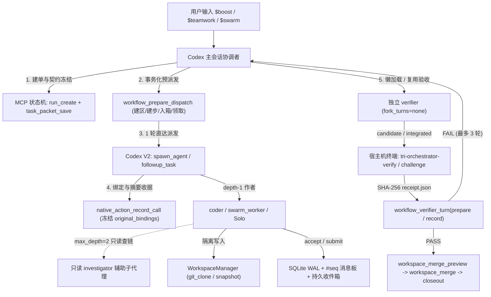
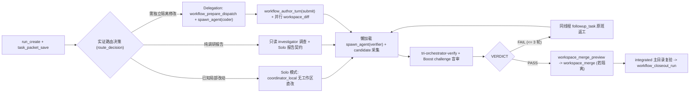
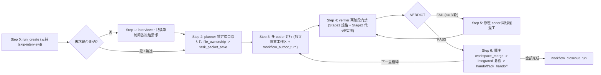
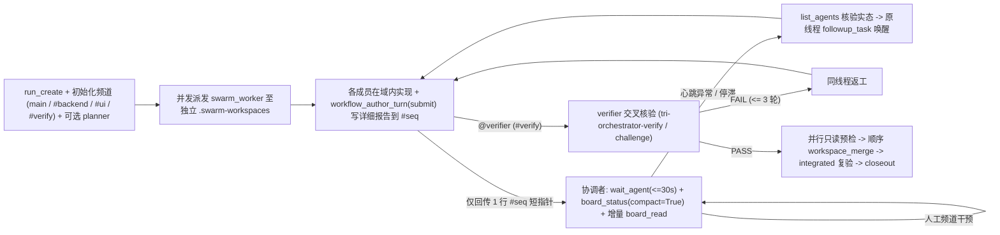

# 三重编排器 (Tri Orchestrator)

面向 Codex CLI / Codex Desktop 的自包含多代理编排插件，提供 **`$boost`**、**`$teamwork`**、**`$swarm`** 三种原生 V2 多代理工作流，由本地单例 HTTP/SSE 守护进程（`127.0.0.1:18790`）、SQLite WAL 状态机、`#seq` 消息板、物理隔离工作区与生命周期钩子组成。

## 核心特性

- **三种编排工作流**：按任务规模选择 `$boost`（单目标极速执行）、`$teamwork`（澄清规划 + 分模块协同）或 `$swarm`（多成员并行 + 频道交接）。
- **物理工作区隔离**：Git 仓库使用 `git clone --local` 隔离分支，非 Git 目录使用三方快照隔离；合入前执行非破坏性冲突预检（`workspace_merge_preview`）。
- **硬验收与并发盲审**：通过 `tri-orchestrator-verify` 冻结产物清单与命令输出生成 SHA-256 验收回执，并支持 `tri-orchestrator-challenge` 只读并发盲审。
- **Codex 本地目录与实时同步**：只读镜像本地 Codex 项目排序、置顶状态与非归档对话（含尚无编排的纯 Codex 对话），按「项目 → Codex 对话 → 编排轮次」三层展示，并通过文件指纹监听实时推送 `codex_catalog_updated` SSE 更新，隔离多会话并发与 `Stop` 钩子检查。
- **模型追踪与辅助子代理观测**：`schema 10` 全链路记录主会话、轮次与子代理的 `model` / `reasoning_effort` / `model_provider`（含触发快照与会话切模对比），并只读解析 Codex `thread_spawn_edges` 派生树以追踪 L2+ 只读辅助子代理与主会话未登记原生子代理。
- **实时中文 Web 控制台**：提供多模式控制台（`/boost`、`/teamwork`、`/swarm`）、`Ctrl+K` 跨项目跨模式与模型检索、含辅助子代理派生的协作图回放、成员检查器与工作区 Diff 检查器。

---

## 环境要求

- **Codex CLI**（支持插件机制、原生 V2 子代理与生命周期钩子）
- **[`uv`](https://docs.astral.sh/uv/)**（管理 Python `>=3.12` 运行环境）
- **`git`**（用于 Git 工作区克隆隔离与合并；非 Git 目录自动回退到目录快照）

---

## 安装与升级

### 方式一：通过 Codex CLI 直接安装（零脚本）

适用于首次安装，无需本地克隆仓库或运行额外脚本：

```bash
codex plugin marketplace add gongyuanshen/codex-orchestrator
codex plugin add tri-orchestrator@tri-orchestrator
```

安装完成后：
- Codex 会将 `./plugin/` 缓存到本地插件目录（`~/.codex/plugins/cache/tri-orchestrator/tri-orchestrator/<version>/`）。
- 首次触发 MCP 工具时，Codex 自动执行 `uv run --quiet --project . python -m orchestrator.mcp_shim` 初始化依赖并拉起后台单例守护进程。
- 若未安装专用角色 TOML，`$boost`、`$teamwork` 与 `$swarm` 调用 `spawn_agent` 时会省略 `agent_type`、`model` 与 `reasoning_effort`，直接继承当前主会话配置并在提示词中内联角色契约。

### 方式二：运行仓库安装脚本（完整角色与钩子配置）

克隆仓库后运行平台脚本，可额外完成 6 个角色 TOML（`~/.codex/agents/`）安装、安全启用 `multi_agent` 与 `multi_agent_v2`、缓存依赖预热以及 `hooks/list` 四钩子自检：

**Windows（PowerShell）：**

```powershell
powershell -ExecutionPolicy Bypass -File scripts/install.ps1
# 如需在 CLI 中直接写入钩子信任哈希，可附加 -TrustPluginHooks
# 默认保留永久基线 tri-orchestrator-baseline + 最近 3 个配置备份，可通过 -KeepBackups N 调整
```

**macOS / Linux（Bash）：**

```bash
bash scripts/install.sh
# 如需在 CLI 中直接写入钩子信任哈希，可附加 --trust-plugin-hooks
# 默认保留永久基线 tri-orchestrator-baseline + 最近 3 个配置备份，可通过 --keep-backups N 调整
```

### 旧版本运行库升级

如果本地已存在旧版 Schema 运行库（例如从 `schema <= 9` 升级至 `0.6.3` / `schema 10`），需先结束全部活跃任务并停止守护进程，再使用 `scripts/upgrade.py` 执行受控备份与离线升级，最后通过 Codex 重新安装插件：

```bash
python scripts/upgrade.py prepare --source-plugin ./plugin --target-plugin <old-plugin-dir> --data-dir <data-dir> --backup-dir <backup-dir>
python scripts/upgrade.py apply --backup-dir <backup-dir>
python scripts/upgrade.py verify --backup-dir <backup-dir> --keep-backups 3
# 如需单独轮转清理旧版升级备份或残留的 plugin-backup-* staging 目录：
python scripts/upgrade.py prune --backup-root <backups-dir> --plugin-cache-dir ~/.codex/plugins/cache/tri-orchestrator --keep-backups 3
```

> 守护进程冷启动不会自动迁移旧版 Schema，也不要直接覆盖旧版托管缓存目录；升级遇到新数据写入后拒绝用旧备份回滚，保留数据进行前向修复。

---

## 编排工作流

| 技能指令 | 编排定位 | 核心角色与通道 | 适用场景 |
| :--- | :--- | :--- | :--- |
| **`$boost`** | 单目标极速执行：实证路由直达或定向委派，强制独立验收与返工闭环。 | `coordinator`、`coder` / `investigator`、`verifier` | 聚焦修复、小中型功能或局部重构。 |
| **`$teamwork`** | 结构化协同流水线：澄清冻结 → 架构划分 → 隔离并行 → 双层验收 → 逐里程碑合入。 | `interviewer`、`planner`、`coder`、`verifier` | 需冻结规格且多模块并行、零文件写冲突的中大型任务。 |
| **`$swarm`** | 基于 `#seq` 频道与持久游标的多成员并发协同、停滞恢复与人工实时干预。 | `planner`（可选）、`swarm_worker`、`verifier`、`#seq` 多频道 | 需要多成员点对点交接与实时协同观测的并行任务。 |

### 三种工作流的通用构建架构

`$boost`、`$teamwork` 与 `$swarm` 均基于同一套 `workflow5` 共享契约（`plugin/skills/route-a-workflow.md`）构建：由 Codex 主会话担任协调者，通过 **原生 V2 子代理工具** 与 **MCP 状态机/账本宏工具** 双向协同完成派发、隔离、验收与收尾：



### `$boost`：单目标极速闭环

核心特点是**按实证复杂度选最小路径**，避免冗余规划开销，同时保留独立的候选验收（`candidate`）、高阶盲审挑战（`challenge`）与合入后主目录复验（`integrated`）：



1. **建单与实证路由**：通过 `run_create` 与 `task_packet_save` 冻结原始需求与验收标准；若存在未知调用链先派发只读 `investigator` 取证，再向 `#seq` 记录 `route_decision`，选择 **Solo**（`coordinator_local`）或 **Delegation**（`create_workspace=True` 隔离工作区）。
2. **候选验收与独立挑战**：作者提交后，首轮候选审查才通过 `workflow_prepare_dispatch(..., dispatch_action="request_verify")` 懒加载实例化 `verifier`（强制 `fork_turns="none"` 保持盲审上下文隔离），运行 `tri-orchestrator-verify` 与 Boost `challenge` 校验，并由协调者对真实 diff 与测试输出做抽检。
3. **同线程返工与一键收尾**：任一标准未过即沿原作者、原验收者线程（`followup_task`）返工，最多 3 轮；候选通过后执行 `workspace_merge_preview` → `workspace_merge`，在主目录完成 `scope="integrated"` 复验，最后调用 `workflow_closeout_run` 单次完成收尾与清理。

### `$teamwork`：澄清规划 + 里程碑协同流水线

核心特点是**角色严格隔离**与**互斥文件所有权矩阵**，确保多 `coder` 并行改码零冲突，并支持多里程碑按依赖序逐个合入与交接：



1. **需求澄清与契约规划**：除非显式携带 `[skip-interview]`，否则先由只读 `interviewer` 逐轮澄清（每轮 1 个高杠杆问题）并冻结需求；随后 `planner` 输出不可重叠的 `file_ownership` 矩阵、验收标准与合并顺序并写入 `task_packet_save`。
2. **隔离并行与双层门禁**：每个并行切片通过 `workflow_prepare_dispatch` 分配独立工作区与 `coder`；`verifier` 执行 Stage 1（需求规格符合性）与 Stage 2（代码质量及 `tri-orchestrator-verify` 实测，高复杂步骤追加 `workflow_review` / `tri-orchestrator-challenge` 四维审查：`specification` / `code` / `stress` / `evidence`）。
3. **顺序合入与里程碑交接**：前置里程碑必须完成 `workspace_merge`、`integrated` 主目录复验及 `handoff` / `ack_handoff`（摘要校验），后续存在文件重叠依赖的里程碑方可准入。

### `$swarm`：`#seq` 消息板高并发协同

核心特点是**分频道异步协同**与**抗上下文爆炸纪律**，各成员将完整改动与日志写入消息板，主协调者仅通过短指针与增量游标保持全局掌控：



1. **频道化与短指针通信**：按领域划分 `main`、`#backend`、`#ui`、`#verify` 等频道；`swarm_worker` 将 Diff 摘要与测试证据通过 `workflow_author_turn(phase="submit", post_board_note=True)` 或 `board_post` 写入消息板，仅向协调者回复单行指针（如 `已完成：<任务>，详见 #14 (@verifier)`），防止多成员大段日志撑爆主会话上下文。
2. **增量游标与停滞恢复**：协调者在 `wait_agent(timeout_ms=30000)` 前后用 `board_status(compact=True)` 与 `board_read(since_seq, advance_cursor=True)` 增量消费消息及 `human` 频道人工指令；遇到心跳告警时先通过原生 `list_agents` 核实真实状态，再在原线程 `followup_task` 唤醒，不凭心跳超时直接新建替代成员。
3. **交叉核验与并发预检合并**：`verifier` 在 `#verify` 频道持续接收各流提交；合并前对多个已验证工作区并发发起只读 `workspace_status` / `workspace_diff` / `workspace_merge_preview`，随后顺序合入、主目录 `integrated` 复验并一键收尾。

### 核心构建机制

- **单轮直达与对账栅栏（`workflow5`）**：派发遵循 `workflow_prepare_dispatch` → 1 轮 `spawn_agent` → `native_action_record_call`，消除子代理首轮空等；若调用超时或中断，动作会锁入 `needs_reconciliation`，协调者必须先调用 `list_agents` 核实宿主状态再执行 `reconcile`，严禁盲目重放 `spawn_agent`。
- **受控辅助子代理分层（`max_depth = 2`）**：仅深度 1 的 `planner`、`coder`、`swarm_worker` 与 `verifier` 可按需派生只读 `investigator` 辅助查链；`interviewer`、`investigator` 与盲审 `challenger` 禁止再派生子代理，确保拓扑可控、成本与权限边界清晰。
- **原班返工上限与双门禁冻结**：首次候选绑定后即永久冻结 `original_bindings`，后续返工（最多 3 轮，超限自动转入 `needs_decision` 待人工决策）与 `integrated` 终验均强制复用同一作者与同一验收者，杜绝“换人重跑”掩盖缺陷。

---

## Web 控制台（`http://127.0.0.1:18790`）

守护进程启动后，在浏览器访问 **`http://127.0.0.1:18790`**（各模式共用同一服务与数据库，入口仅作展示分区）：

- **模式入口**：[`/boost`](http://127.0.0.1:18790/boost)、[`/teamwork`](http://127.0.0.1:18790/teamwork)、[`/swarm`](http://127.0.0.1:18790/swarm)，支持携带 `run_id` 链接直达历史任务。
- **三层导航与全局检索**：按「Codex 项目 → 对话（含无编排纯对话）→ 编排轮次」组织侧栏与项目选择器（Codex 目录不可用时自动回退至已登记项目与会话）；支持 `Ctrl+K` 跨项目、跨模式及按模型/推理强度检索，并标记同项目非隔离直改并发风险。
- **概况与日志**：展示任务状态、主对话实时模型与触发快照对比（切模时标注 `⇄`）、模型分布汇总、触发原话、执行目录与带模型徽章的轮次分隔/消息流，支持全文展开及 `.md` / `.json` 运行报告导出（含模型与辅助子代理明细）。
- **消息板与人工干预**：按频道、`@提及` 与关键词过滤 `#seq` 消息流，底部可向 `human` 频道发送人工指令。
- **成员与协作图**：展示冻结任务契约、互斥文件矩阵、成员模型/线程信息、心跳/卡死分类、L2+ 辅助子代理树与主会话未登记原生子代理；交互式 SVG 协作图支持回放、节点模型展示及「显示辅助子代理」派生连线开关。
- **工作区检查器**：查看文件变更与统一 Diff，执行冲突预检、打开本地目录、请求暂停/停止成员及受门禁保护的清理操作（`git push`、`reset` 与未合入强制删除端点均禁用并返回 `HTTP 403`）。

---

## 工作区、依赖与运行边界

- **工作区隔离模式**：
  - `mode="git_clone"` 需要在分配分支提交真实 commit SHA，并在验收/合入前保持工作树干净。
  - `mode="snapshot"` 下 `branch_name=None` 属正常状态；合入前 `dirty=true` 表示相对基线存在改动，合入与清理按三方目录快照基线核验。
  - 两种模式均应先执行 `workspace_merge_preview`，再执行 `workspace_merge(strategy="merge")` 与 `workspace_cleanup`。
- **依赖目录策略（`dep_mode`）**：
  - `none` 不配置依赖目录；需要独立依赖副本时使用 `copy`。
  - `fresh_venv_uv` 创建全新 `.venv` 供测试安装依赖，不负责创建 `node_modules`。
  - `link_ro_cache` 为兼容历史保留的命名，底层采用目录链接/硬链接（失败时复制），属于**共享可写**依赖而非只读隔离；需要写入隔离时请改用 `copy` 或 `fresh_venv_uv`。
- **控制、重试与结果传递语义**：
  - 守护进程与看门狗不会自动代调或重启原生代理，也不会自动跨步骤重放结果未知的写操作；人工文字消息不会自动投递给子代理，暂停/结束请求由协调者在工具边界读取并执行原生中断后回执。
  - 成员状态由协调者登记，不通过后台扫描原生进程推断；守护进程与钩子仅**只读**采集 Codex 本地目录、模型/推理强度与子代理派生树（离线时保留历史快照），绝不会修改 Codex 的模型或网络代理配置。
  - L2+ 只读辅助子代理（`max_depth = 2`）仅允许深度 1 角色用于跨模块只读调查，不得编辑源码、不向编排器注册为作者/验收者，也不提交独立验收回执。
  - 当 MCP 单次返回体超过 stdio 内联预算时，完整 JSON 会原子落盘至运行时目录 `results/` 下，并返回含路径、字节数与 SHA-256 的 `delivery: "file"` 回执（直接读取结果文件，勿重复重放写操作）。

---

## 磁盘占用、缓存位置与清理机制

### 1. 非 Git 目录 `snapshot` 隔离、体积上限与 `.triignore` 过滤

- 当目标目录不是 Git 仓库时，`WorkspaceManager` 会回退至 `mode="snapshot"`，将受纳文件复制一份到 `<project_root>/.swarm-workspaces/<run>-<worker>` 作为三方比较基线。
- **体积阈值保护（`TRI_ORCH_MAX_SNAPSHOT_MB`）**：在执行快照拷贝前会先估算源目录的文件数与总字节数；默认上限为 **`500` MB**（设为 `0` 表示不限制）。一旦超限将直接拒绝创建并给出明确错误提示，严禁静默硬拷贝数 GB 构建目录；可通过改用 Git 仓库、缩小 `execution_root`、配置 `.triignore` 或调整环境变量解决。
- **内置排除与 `.triignore`**：快照与状态比对会自动跳过内置 `SNAPSHOT_EXCLUDE_DIRS`（含 `.swarm-workspaces`、`.git`、`node_modules`、`.venv`、`__pycache__`、`.pytest_cache`、`.ruff_cache`、`.mypy_cache` 以及常见构建/缓存目录 `bin`、`obj`、`dist`、`build`、`out`、`target` 等），并支持在项目根目录放置可选 **`.triignore`** 文件（按行配置目录名或 glob 模式进行过滤）。

### 2. 数据目录、隔离工作区与备份位置及生命周期

| 存储路径 | 内容组成 | 生命周期与清理边界 |
| :--- | :--- | :--- |
| **`%LOCALAPPDATA%\tri-orchestrator`**（Windows）<br>`~/.local/share/tri-orchestrator`（POSIX）<br>（`TRI_ORCH_DATA_DIR`） | - `state.db`：SQLite WAL 状态机库<br>- `daemon.log` / `shim.log`：运行日志（`RotatingFileHandler` 自动轮转）<br>- `results/`：超大 MCP 返回体缓存 JSON<br>- `receipts/`：派发与验收 SHA-256 回执 | `state.db` 与 `receipts/` 长期留存以保留审计轨迹；`results/` 下缓存文件超过 `TRI_ORCH_RESULT_TTL_SEC`（默认 `86400` 秒）或超出最近 `TRI_ORCH_RESULT_MAX_FILES`（默认 `50` 份）时自动清理。 |
| **`<project_root>/.swarm-workspaces/`** | 每个隔离写入子代理一个子目录（`git_clone` 或 `snapshot` 复制目录） | 任务结束调用 `workflow_closeout_run` / `workspace_cleanup` 时自动回收；已合入且无未提交改动的过期工作区超过 `TRI_ORCH_WORKSPACE_RETENTION_SEC`（默认 `86400` 秒）由 GC 安全删除。**凡存在未合入新增/修改文件的工作区绝不自动删除**，需人工核查合入或手动处置。 |
| **`~/.codex/backups/`** 与<br>`~/.codex/plugins/cache/tri-orchestrator/` | - `tri-orchestrator-baseline`：首次安装前配置基线<br>- `tri-orchestrator-2*`：历次安装配置与角色备份<br>- `plugin-backup-*`：插件重装/升级残留 staging 目录 | 安装脚本仅备份 `config.toml` 与必要角色 TOML（绝不拷贝 `.venv`），永久保留唯一 `tri-orchestrator-baseline` 与最近 `N=3` 个时间戳备份（`-KeepBackups` / `--keep-backups` 可覆盖）；`scripts/upgrade.py verify` / `prune` 轮转清理已验证完成的旧升级备份与过期 `plugin-backup-*` staging 目录。 |

### 3. 三种存储清理与 GC 触发方式

1. **后台定时自动 GC**：守护进程内嵌周期 GC 任务（默认每隔 `TRI_ORCH_GC_INTERVAL_SEC=3600` 秒执行一次），仅清理过期 `results/` 缓存以及所属轮次已完成/归档、状态为 `merged` 且静态无未合入变更、超过保留期的隔离工作区。
2. **Web 控制台「存储与清理」面板**：打开 `http://127.0.0.1:18790` 点击顶栏「**存储与清理**」按钮，可实时查看运行时目录各子项占用、逐条区分 `.swarm-workspaces` 状态（「可安全清理」、「含未合入变更待核查」、「进行中」），并一键执行安全清理。
3. **离线 / 手动运行 CLI**：无需打开浏览器或启动 Web 服务，可在终端直接执行垃圾回收（支持在线或离线 SQLite WAL）：

```bash
# 常规安全清理（清理过期 results/ 与达到保留期限的已合入无脏改动工作区）
tri-orchestrator-daemon --gc

# 仅预演估算可释放空间，不实际删除任何文件
tri-orchestrator-daemon --gc --gc-dry-run

# 立即清理所有已完成/已归档轮次的已合入且无未合入改动的工作区（跳过等待保留期）
tri-orchestrator-daemon --gc --gc-all-completed

# 也可直接通过独立 GC 模块运行
python -m orchestrator.gc --dry-run
```

---

## 架构与目录结构

```text
Codex CLI / V2 Subagents / Lifecycle Hooks
   │  stdio JSON-RPC (mcp_shim) / 本地 HTTP RPC (hook_runner)
   ▼
CLI 入口：tri-orchestrator-{mcp,daemon,verify,hook,challenge}
   │  daemon.lock 互斥锁（hook 在守护进程离线时静默退出，不自动拉起服务）
   ▼
单例 HTTP/SSE 守护进程（127.0.0.1:18790）
   ├── /api/rpc & /api/tools   ──► RpcDispatcher（35 个公开 MCP 工具 + 1 个内部钩子 RPC）
   ├── /api/projects, /api/codex/catalog, /api/sessions, /api/runs & /api/events（SSE 实时流）
   ├── /, /boost, /teamwork, /swarm（中文 Web 控制台）
   ├── Watchdog Loop           ──► 进展分类与卡死/人工决策告警
   ├── Codex Catalog Watcher   ──► 状态文件指纹监测与 codex_catalog_updated 推送
   ├── SQLite WAL Engine       ──► schema 10（projects, runs, session_turns,
   │                               session_run_bindings, task_packets, workers,
   │                               worker_subagents, board_messages, workspaces 等）
   └── WorkspaceManager        ──► .swarm-workspaces/<run>-<worker> + 端口池
```

```text
.
├── .agents/plugins/marketplace.json   # Codex 本地市场清单
├── plugin/                            # 自包含 Codex 插件包
│   ├── .codex-plugin/plugin.json      # 插件元数据、skills/hooks/mcp 声明
│   ├── .mcp.json & mcp.json           # Codex MCP 启动配置
│   ├── hooks/hooks.json               # SessionStart / PostCompact / UserPromptSubmit / Stop
│   ├── agents/*.toml                  # 6 个角色定义（interviewer/planner/investigator/coder/verifier/swarm_worker）
│   ├── skills/                        # route-a-workflow.md 与 {boost,teamwork,swarm}/SKILL.md
│   ├── src/orchestrator/              # 守护进程、MCP shim、桥接器、钩子、验收/盲审运行器与 Web 前端
│   └── pyproject.toml & uv.lock       # 插件运行时依赖与 CLI 入口定义
├── scripts/                           # install.ps1 / install.sh / uninstall.ps1 / upgrade.py / verify_e2e.ps1
├── tests/                             # 单元、契约、UI 与端到端测试套件
└── pyproject.toml & uv.lock           # 仓库开发与测试环境配置
```

---

## CLI 可执行程序与 MCP 工具

### CLI 入口（5 个）

| 可执行程序 | 入口模块 | 用途说明 |
| :--- | :--- | :--- |
| `tri-orchestrator-mcp` | `orchestrator.mcp_shim:main` | Codex stdio MCP 桥接层，按互斥锁确保单例守护进程在线并转发 MCP 工具调用。 |
| `tri-orchestrator-daemon` | `orchestrator.daemon:main` | 本地 HTTP/SSE 守护进程，承载 SQLite WAL 状态机与 Web 控制台。 |
| `tri-orchestrator-verify` | `orchestrator.verify_runner:main` | 终端验收采集器，按冻结清单与白名单 `env_profile` 执行命令并输出 SHA-256 `receipt.json`。 |
| `tri-orchestrator-hook` | `orchestrator.hook_runner:main` | 生命周期钩子运行器（硬超时 `<=1.5s`，离线静默 `exit 0`）。 |
| `tri-orchestrator-challenge` | `orchestrator.challenge_runner:main` | 宿主侧只读并发盲审采集器，校验零源码突变并生成挑战回执。 |

### 公开 MCP 工具（35 个）

> `/api/rpc` 另保留 1 个内部接口 `session_hook_check` 供本地 `tri-orchestrator-hook` 调用，不暴露于模型 `tools/list`。

| 分类 | 工具列表 |
| :--- | :--- |
| **运行与会话** | `run_create`、`run_update`、`run_list`、`session_bind` |
| **任务契约** | `task_packet_save`、`task_packet_get` |
| **消息板 (`#seq`)** | `board_post`、`board_read`、`board_status`、`board_channel_list` |
| **成员与控制** | `worker_register`、`worker_heartbeat`、`worker_status_update`、`worker_control_ack` |
| **原生派发账本** | `workflow_prepare_dispatch`、`native_action_record_call`、`native_action_update` |
| **持久收件箱** | `inbox_send`、`inbox_get`、`inbox_ack`、`inbox_wait` |
| **工作流与验收** | `workflow_step_save`、`workflow_step_advance`、`workflow_author_turn`、`workflow_verifier_turn`、`artifact_capture`、`verification_record`、`workflow_review`、`workflow_closeout_run` |
| **隔离工作区** | `workspace_create`、`workspace_status`、`workspace_diff`、`workspace_merge_preview`、`workspace_merge`、`workspace_cleanup` |

---

## 运行时环境变量

| 变量名 | 默认值 | 说明 |
| :--- | :--- | :--- |
| `TRI_ORCH_HOST` | `127.0.0.1` | 守护进程监听地址。 |
| `TRI_ORCH_PORT` | `18790` | 守护进程 HTTP/SSE 端口。 |
| `TRI_ORCH_DATA_DIR` | `%LOCALAPPDATA%\tri-orchestrator`（Windows）<br>`~/.local/share/tri-orchestrator`（POSIX） | 运行时数据目录（`state.db`、`daemon.lock`、`daemon.pid.json`、`results/`、日志等）。 |
| `TRI_ORCH_STALL_SEC` | `300` | 成员心跳停滞告警阈值（秒）。 |
| `TRI_ORCH_WATCHDOG_INTERVAL_SEC` | `15` | 看门狗巡检间隔（秒）。 |
| `TRI_ORCH_PORT_RANGE` | `18800..18999` | 隔离工作区测试端口池范围。 |
| `TRI_ORCH_MAX_SNAPSHOT_MB` | `500` | 非 Git 目录 `snapshot` 模式允许复制的最大估算体积（MB），`0` 表示不限制。 |
| `TRI_ORCH_GC_INTERVAL_SEC` | `3600.0` | 守护进程后台定时 GC 轮询间隔（秒）。 |
| `TRI_ORCH_RESULT_TTL_SEC` | `86400` | `results/` 下 MCP 大结果缓存文件的保留时长（秒）。 |
| `TRI_ORCH_RESULT_MAX_FILES` | `50` | `results/` 目录下最多保留的近期缓存文件数量。 |
| `TRI_ORCH_WORKSPACE_RETENTION_SEC` | `86400` | 已完结轮次中已合入且无脏改动的 `.swarm-workspaces` 工作区保留时长（秒）。 |
| `TRI_ORCH_HOOK_TIMEOUT_SEC` | `1.2` | `tri-orchestrator-hook` 本地 RPC 默认超时（秒，硬上限 `1.5`）。 |
| `TRI_ORCH_BASE_URL` | 空（按 `HOST`/`PORT` 拼装） | 可选显式覆盖 `tri-orchestrator-hook` 请求的守护进程基础 URL。 |
| `CODEX_HOME` | `~/.codex` | Codex 本地目录路径；只读目录/模型桥接及安装卸载脚本据此定位状态库与 `agents/`。 |

---

## 开发测试与卸载

### 运行测试

```bash
uv run pytest -v
```

### 卸载

**零脚本卸载：**

```bash
codex plugin remove tri-orchestrator@tri-orchestrator
codex plugin marketplace remove tri-orchestrator
```

**Windows 脚本卸载（自动停服、移除插件与市场、还原配置与角色备份）：**

```powershell
powershell -ExecutionPolicy Bypass -File scripts/uninstall.ps1
# 可选参数：-RestoreConfigBackup -RemoveDataDir
```

**macOS / Linux**：执行上述 `codex plugin ...` 移除命令后，按需清理 `~/.codex/agents/` 下对应角色文件，停止 `daemon.pid.json` 进程并清理 `~/.local/share/tri-orchestrator`。

---

## 许可证

[MIT](LICENSE)
